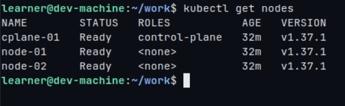
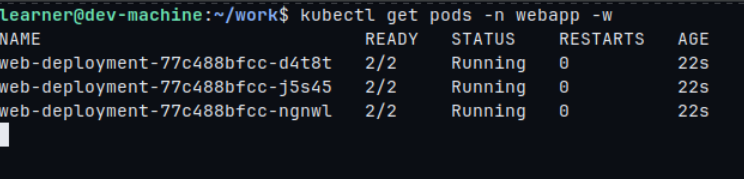
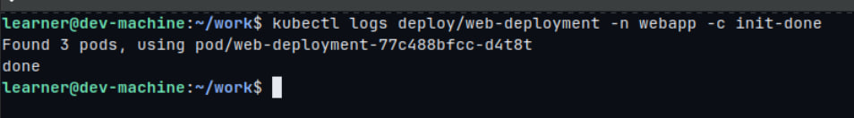
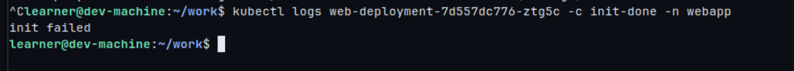
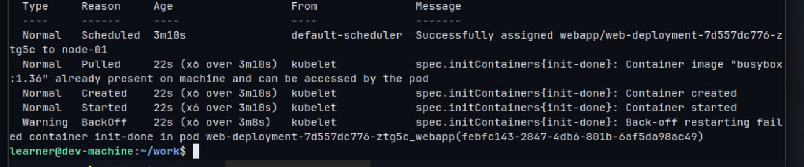
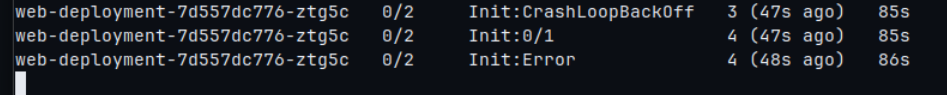
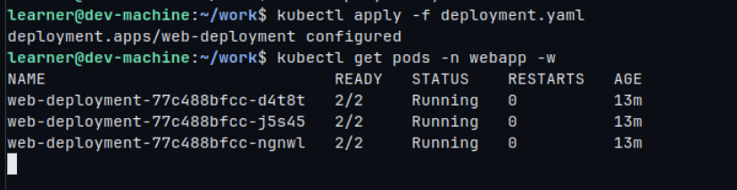

# Task 1: Multi-Container Pods (Init Container & Sidecar)

Documentation and manifest submission for **Task 1: Multi-Container Pods** on a 3-node Minikube cluster.

---

## 📁 Repository Structure

```text
Kubernetes Course Tasks/
└── Task-1/
    ├── README.md           # Task documentation & verification
    ├── deployment.yaml     # Kubernetes Deployment manifest
    └── screenshots/        # Proof of execution screenshots
        ├── 01-cluster-nodes.png
        ├── 02-deployment-running.png
        ├── 03-init-logs.png
        ├── 04-sidecar-ps.png
        ├── 05-time-update.png
        ├── 06-no-volumes.png
        ├── 07-failing-init.png
        ├── 08-describe-pod.png
        └── 09-fixed-rollout.png
```

---

## 🏗️ Architecture & Specs

The Pod runs **without volumes** and contains **3 containers** utilizing shared process namespaces (`shareProcessNamespace: true`):

| Container Name | Type | Image | Function / Description |
| :--- | :--- | :--- | :--- |
| **`init-done`** | Init Container | `busybox:1.36` | Prints `done` and exits (`exit 0`). The application containers start only if this succeeds. |
| **`nginx`** | Main Container | `nginx:1.27` | Generates initial `index.html` with server time and runs Nginx on port 80 in foreground. |
| **`time-updater`** | Sidecar Container | `busybox:1.36` | Uses `SYS_PTRACE` capability to locate Nginx PID via shared process namespace and rewrites `/proc/$PID/root/usr/share/nginx/html/index.html` every 5 seconds. |

---

## 🚀 Execution & Step-by-Step Implementation

### Step 1: Cluster Setup & Namespace Creation
Started a 3-node Minikube cluster using Calico CNI and created the `webapp` namespace:

```bash
minikube start --nodes 3 --cni calico --cpus 2 --memory 2200
kubectl create namespace webapp
```

**Verification:**
```bash
kubectl get nodes
```


---

### Step 2: Deploying the Application

Applied the `deployment.yaml` containing 3 replicas and matching labels (`app: web`):

```bash
kubectl apply -f deployment.yaml
kubectl get pods -n webapp -w
```

**Verification:**
```bash
kubectl get deploy web-deployment -n webapp
kubectl get pods -n webapp -l app=web
```


---

### Step 3: Verifying Functionality

#### 1. Init Container Logs
Confirmed that `init-done` succeeded and logged `done`:
```bash
kubectl logs deploy/web-deployment -n webapp -c init-done
```



---

### Step 4: Testing Init Failure & Rollout Behavior

Modified the init container command to trigger exit code 1:
```yaml
initContainers:
- name: init-done
  image: busybox:1.36
  command: ["sh", "-c", "echo 'init failed'; exit 1"]
```

Applied the updated deployment and observed rollout:
```bash
kubectl apply -f deployment.yaml
kubectl get pods -n webapp -l app=web
kubectl describe pod <new-failing-pod> -n webapp
```



#### 📝 Analysis & Question Answers:

1. **Which status does the new Pod show?**
   * The new pod shows status `Init:CrashLoopBackOff` or `Init:Error` with `READY 0/2`.
2. **Do `nginx` and `time-updater` start?**
   * **No.** Kubernetes enforces strict sequence: all Init Containers must run and exit successfully (`0`) before any main/sidecar containers are started.
3. **Is the web page still reachable, and why?**
   * **Yes.** Kubernetes uses a Rolling Update deployment strategy. Because the newly created pod fails initialization, it never reaches a `Ready` state. Consequently, Kubernetes halts the rollout and retains the 3 existing, healthy pods (`READY 2/2`) to serve incoming traffic without downtime.

---

### Step 5: Fixing the Deployment

Reverted the init command back to `["sh", "-c", "echo done"]` and re-applied:

```bash
kubectl apply -f deployment.yaml
kubectl get deploy web-deployment -n webapp
```


---

## 📊 Verification Summary Checklist

| # | Item | Command | Target / Expected Result | Status |
| :-: | :--- | :--- | :--- | :-: |
| 1 | **3 Nodes Ready** | `kubectl get nodes` | `minikube`, `minikube-m02`, `minikube-m03` Ready | ✅ Passed |
| 2 | **Deployment Ready** | `kubectl get deploy web-deployment -n webapp` | `READY 3/3`, `UP-TO-DATE 3` | ✅ Passed |
| 3 | **Pod Status** | `kubectl get pods -n webapp -l app=web` | 3 Pods running with `READY 2/2` | ✅ Passed |
| 4 | **Init Output** | `kubectl logs deploy/web-deployment -n webapp -c init-done` | Outputs `done` | ✅ Passed |
| 5 | **Shared Namespace** | `kubectl exec ... -c time-updater -- ps` | `nginx: master process` visible | ✅ Passed |
| 6 | **Dynamic Timestamp** | `cat /usr/share/nginx/html/index.html` | Timestamp updates every 5s | ✅ Passed |
| 7 | **Zero Volumes** | `{.spec.template.spec.volumes}` | `[]` (Empty output) | ✅ Passed |
| 8 | **Failure Isolation** | `kubectl apply -f deployment.yaml` (broken) | Rollout halts; old pods remain active | ✅ Passed |
