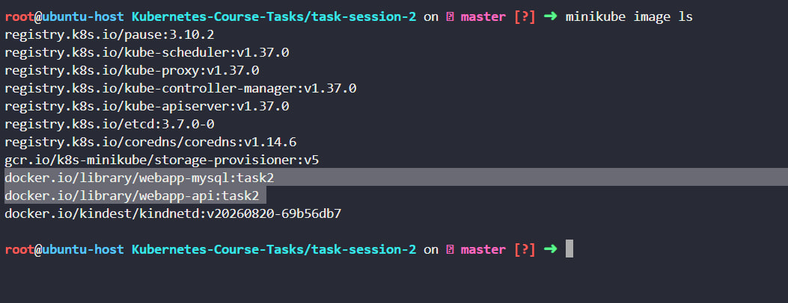
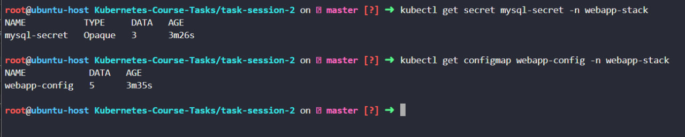
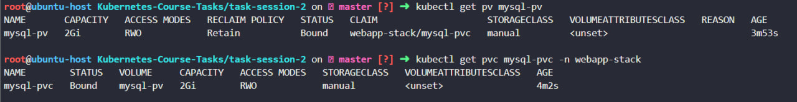
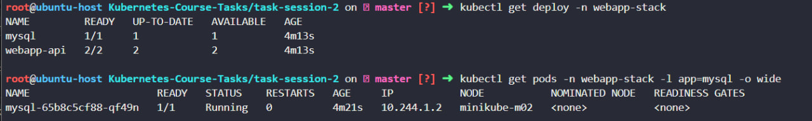

# 🚀 Task 2: FastAPI + MySQL with ConfigMap, Secret & Ingress

## 📝 Overview

In this task, a multi-tier web application stack was deployed on a multi-node Minikube cluster inside the `webapp-stack` namespace. The stack consists of a **FastAPI** web application (2 replicas) backed by a persistent **MySQL 8.4** database, utilizing Kubernetes **ConfigMaps**, **Secrets**, **PersistentVolumes**, and an **NGINX Ingress Controller** for external routing.

## 🏗️ Architecture & Key Components

* **Namespace:** `webapp-stack`

* **Database Layer (`mysql`):**

  * **Storage:** `mysql-pv` (`2Gi`, `hostPath: /data/webapp-mysql`, pinned to node `minikube-m02` via `nodeAffinity`) bound to `mysql-pvc` (`storageClassName: manual`).

  * **Deployment:** 1 replica using `Recreate` strategy to prevent concurrent data directory locks.

  * **Service:** `mysql` (`ClusterIP` on port `3306`).

* **Application Layer (`webapp-api`):**

  * **Deployment:** 2 replicas running `webapp-api:task2` on port `8000` with `/health` liveness and readiness probes.

  * **Configuration:** Non-sensitive config injected via `webapp-config` (`ConfigMap`); database credentials injected via `mysql-secret` (`Secret`).

  * **Service:** `webapp-api` (`ClusterIP` mapping port `80` $\rightarrow$ `8000`).

* **Ingress Layer (`webapp-ingress`):**

  * Routes external HTTP traffic (`/` prefix) via `ingressClassName: nginx` to the `webapp-api` service on port `80`.

## 📂 Kubernetes Manifests

```
task-session-2/
├── webapp-secret.yaml           # mysql-secret credentials
├── webapp-config.yaml           # webapp-config environment variables
├── pv-pvc.yaml                  # PersistentVolume (pinned to minikube-m02) & PVC
├── mysql-deployment.yaml        # MySQL Deployment
├── mysql-svc.yaml               # MySQL ClusterIP Service
├── webapp-api-deployment.yaml   # FastAPI Deployment (2 replicas)
├── webapp-api-svc.yaml          # FastAPI ClusterIP Service
└── webapp-ingress.yaml          # NGINX Ingress resource

```

## 🛠️ Execution Steps

1. **Image Build & Load:** Built `webapp-api:task2` and `webapp-mysql:task2` locally and loaded both images directly into the Minikube registry (`minikube image load`).

2. **Namespace, Secrets & ConfigMaps:** Created the `webapp-stack` namespace and applied `webapp-secret.yaml` and `webapp-config.yaml` (explicitly defining `MYSQL_PORT="3306"` to avoid Kubernetes service environment variable collisions).

3. **Storage Provisioning:** Applied `pv-pvc.yaml` to create `mysql-pv` with `nodeAffinity` targeting `minikube-m02` and bound it to `mysql-pvc`.

4. **Workloads & Services:** Deployed the MySQL backend (`mysql-deployment.yaml`, `mysql-svc.yaml`) and the 2-replica FastAPI frontend (`webapp-api-deployment.yaml`, `webapp-api-svc.yaml`).

5. **Ingress Routing:** Enabled the NGINX Ingress controller and applied `webapp-ingress.yaml`.

## 🔍 Verification & Screenshots

Below is the step-by-step verification matching all 12 checks from the task table:

### 1. Images Loaded

* **Command:** `minikube image ls`

* **Expected Result:** Both `webapp-api:task2` and `webapp-mysql:task2` are listed.


  

### 2. Secret and ConfigMap

* **Commands:**

  ```
  kubectl get secret mysql-secret -n webapp-stack
  kubectl get configmap webapp-config -n webapp-stack
  
  ```

* **Expected Result:** `DATA` shows `3` for `mysql-secret` and `5` for `webapp-config`.

  

### 3. PV and PVC Bound

* **Commands:**

  ```
  kubectl get pv mysql-pv
  kubectl get pvc mysql-pvc -n webapp-stack
  
  ```

* **Expected Result:** Status `Bound`, Capacity `2Gi`.


  

### 4. Deployments Ready

* **Command:** `kubectl get deploy -n webapp-stack`

* **Expected Result:** `mysql` shows `1/1`, and `webapp-api` shows `2/2`.


  

### 5. MySQL on the PV Node

* **Command:** `kubectl get pods -n webapp-stack -l app=mysql -o wide`

* **Expected Result:** `1/1 Running` scheduled on `NODE` `minikube-m02`.

* **Screenshot:**
  

### 6. App Environment Variables

* **Command:** `kubectl exec -n webapp-stack deploy/webapp-api -- env`

* **Expected Result:** Displays `APP_TITLE`, `MYSQL_HOST=mysql`, `MYSQL_USER`, and `MYSQL_PASSWORD`.

* **Screenshot:**
  

### 7. Default Database Data

* **Command:**

  ```
  kubectl exec -n webapp-stack deploy/mysql -- sh -c 'mysql -uroot -p"$MYSQL_ROOT_PASSWORD" -e "SELECT * FROM webapp.messages"'
  
  ```

* **Expected Result:** Displays the 2 default messages initialized in the `messages` table.

* **Screenshot:**
  

### 8. Ingress Resource

* **Command:** `kubectl get ingress webapp-ingress -n webapp-stack`

* **Expected Result:** `CLASS` is `nginx` and `ADDRESS` is populated.

* **Screenshot:**
  

### 9. App Info Endpoint

* **Command:** `curl http://localhost:8080/api/info`

* **Expected Result:** Returns JSON containing `"version": "task2"`, `"title": "hello in MLOPS MENA COMMUNITY"`, `"environment": "dev"`, and `db` connection info.

* **Screenshot:**
  

### 10. Write a Message (`POST`)

* **Command:**

  ```
  curl -X POST http://localhost:8080/api/messages -H "Content-Type: application/json" -d '{"author":"student","content":"hello"}'
  
  ```

* **Expected Result:** Returns `{"id": 3, "written_to": "mysql-..."}`.


  

### 11. Read Messages (`GET`)

* **Command:** `curl http://localhost:8080/api/messages`

* **Expected Result:** Returns your newly posted message (`id: 3`) along with the 2 default messages.

* **Screenshot:**
  

### 12. Data Survives a Pod Restart

* **Commands:**

  ```
  kubectl delete pod -n webapp-stack -l app=mysql
  curl http://localhost:8080/api/messages
  
  ```

* **Expected Result:** After the MySQL pod recreates on `minikube-m02`, your message (`id: 3`) is still persisted and returned.

* **Screenshot:**
  
